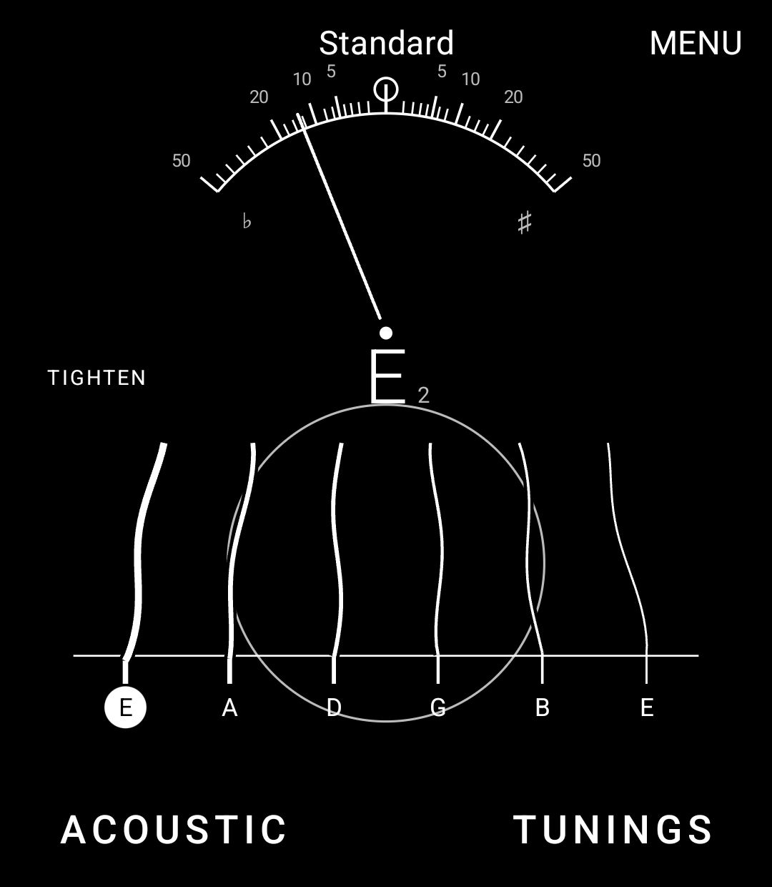
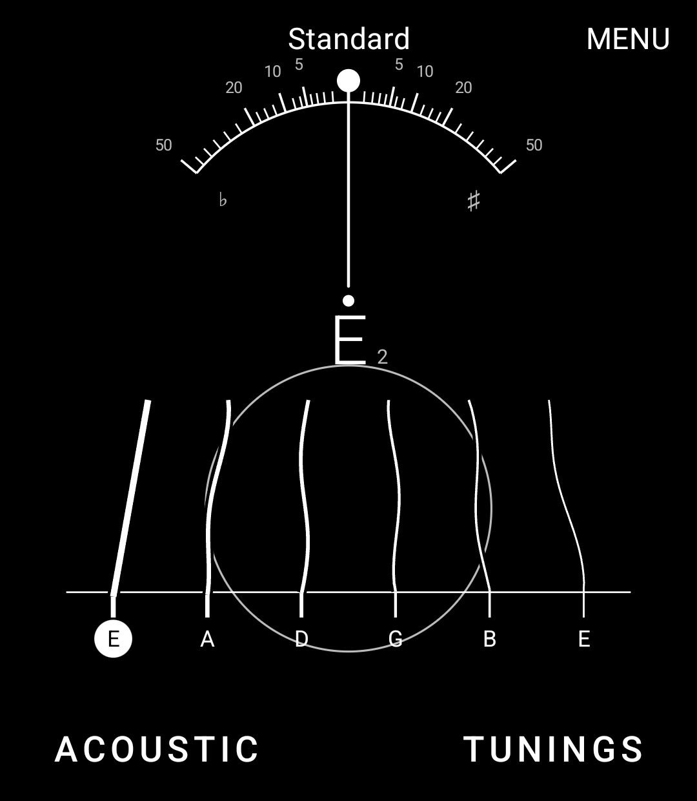
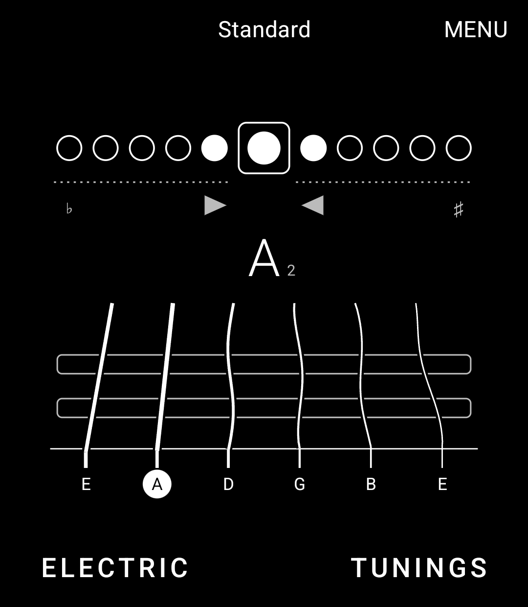
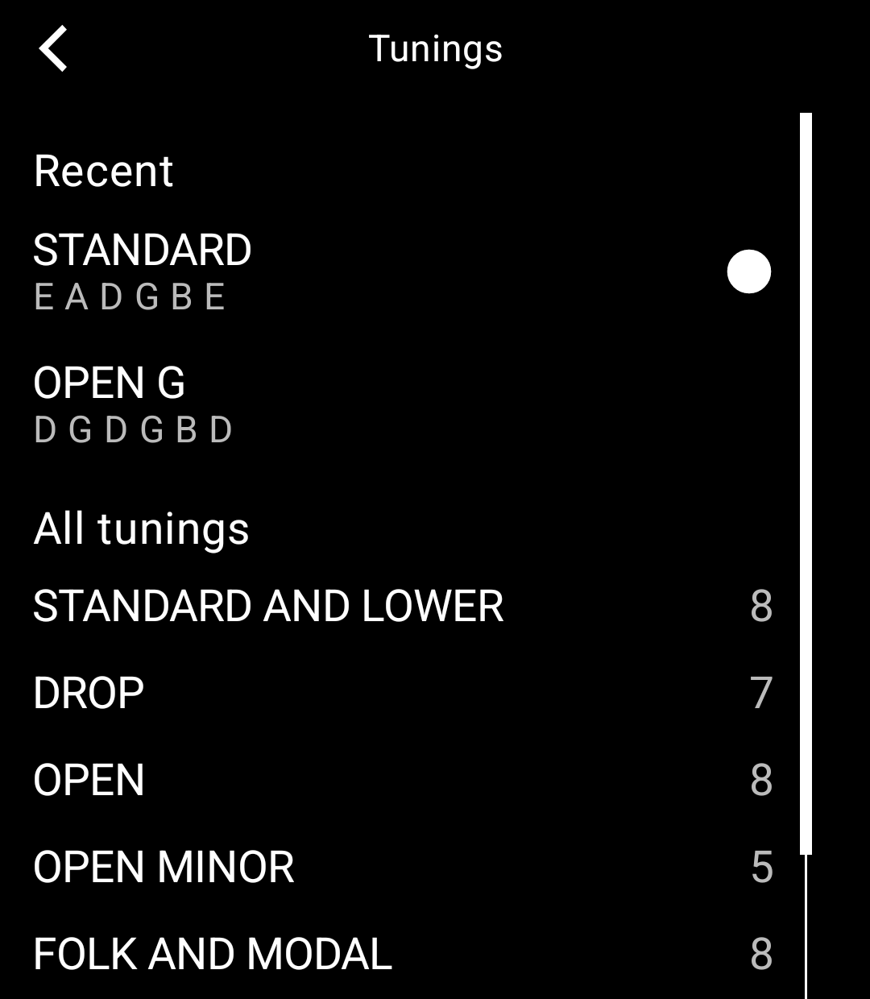

# Guitar Tuner

A guitar tuner for the Light Phone III, built with the [Light SDK](https://github.com/lightphone/light-sdk) by Slow Pixels.

<p>
  
  
  
  
</p>

You look straight down at the guitar. The six strings run up the screen, over the soundhole on the acoustic or the
pickups on the electric, to a meter at the top: a needle on the acoustic, a row of lights as on a tuning pedal on the
electric. Play a string and the meter finds it. Each string starts **slack**, in a lazy wave, because nothing has
been heard from it yet; it tightens as it nears its note and is pulled **straight** when it gets there, with the lamp
lit and a bell. It stays straight, so a guitar in tune is six clean lines.

- **57 tunings** in seven groups: standard and lower, drop, open, open minor, folk and modal, slack key, and the odd and
  famous ones (Nashville, DADGAD, Bron‑Yr‑Aur, new standard…). A tuning that takes a string more than a whole step above
  standard says "Light strings" in the list, because an ordinary set can snap.
- **Acoustic or electric** (the bottom bar). An unplugged electric is quiet, so it gets a lower bar on the mic.
- **Tap a string** to listen for it alone; tap again to listen for them all. **Hold a string** to hear its note.
- **Reference pitch** from 432 to 446 Hz, printed on the face when it isn't 440.
- **Chime** on or off: a small bell in the string's own note, three octaves up, so it sits in harmony with the string
  still ringing. The last string plays all six in a run.

## Privacy

It asks for the microphone and nothing else. What the mic hears is looked at for a fraction of a second and gone;
nothing is kept or sent, and the tool can't reach the internet (`lighttool.toml` asks only for `RECORD_AUDIO`). Your
tuning, guitar and settings stay in a small file in the tool's own storage.

## How it hears

`audio/Pitch.kt` works out the note. A phone's mic hears very little of a low string's fundamental, so it looks for the
sound repeating (the McLeod method) rather than the loudest frequency. The sound is thinned to 12 kHz; the first repeat
fixes the note, then a lag of many periods is timed, doubling each step, which is where the accuracy comes from.
`model/Judge.kt` decides which string it is and when it's in tune (within 3 cents for 280 ms, by the middle of the last
five readings, because a string rings sharp after the pick and wanders as it fades). `audio/Ear.kt` reads the mic
through Light's `LightAudioCapture` and learns how quiet the room is rather than using a fixed level. The bell and the
plucked notes are made from nothing in `audio/Bell.kt` and played through `LightAudioVoice`, so there are no sound files.

The pitch code has no Android in it: `src/test` plays made-up strings to it (thin on bass, noisy, partials a little
sharp, settling after the pick), every string of every tuning, and whole tuning sessions to the judge and the ear.

## How it fits LightOS

- Screens are Light's kit; the face is one Compose canvas in Light's line-and-type look, in whichever theme the phone is
  in.
- The mic runs only while the tuner's own screen is in front. The screen stays on while there's something to hear,
  and for two minutes after; the flag is only held between `willShow` and `onAppPause`, so it's never left set.
- Raw mic input (`MicSource.Unprocessed`) is asked for first, which skips the phone's voice processing; a phone that
  can't give it falls back to the ordinary mic.

## Building

This is a copy of Light's SDK (version 0.2.3, commit 2f02ecd) with the tool in `tool/`. Build it as any Light tool:

```bash
./gradlew :tool:installDebug
```

To run it on the LightOS emulator, see [the emulator guide](docs/system_app/README.md). The tests:

```bash
./gradlew :tool:testDebugUnitTest
```

The emulator has no microphone. In a debug build, a file `test-feed.pcm` (raw mono 16-bit 48 kHz) in the tool's own
files folder plays in place of the mic; `FeedFileTest` writes a tuning session to try:

```bash
FEED_OUT=/tmp/test-feed.pcm ./gradlew :tool:testDebugUnitTest --tests '*FeedFileTest'
adb push /tmp/test-feed.pcm /data/local/tmp/ && adb shell run-as com.slowpixels.guitartuner cp /data/local/tmp/test-feed.pcm files/
```

## Licence

MIT, as the SDK is. See [LICENSE](LICENSE) for the SDK and [LICENSE-GUITAR-TUNER](LICENSE-GUITAR-TUNER) for the code in `tool/`.
